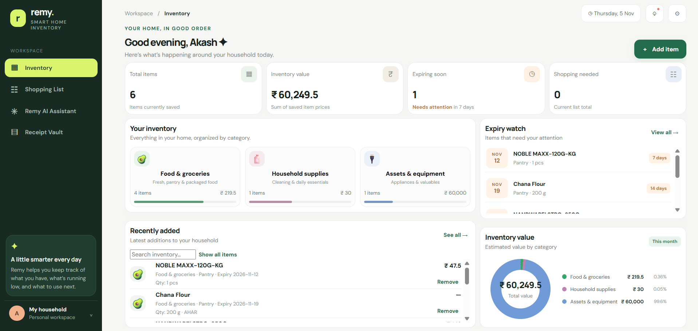
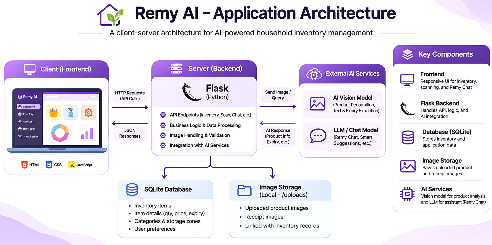
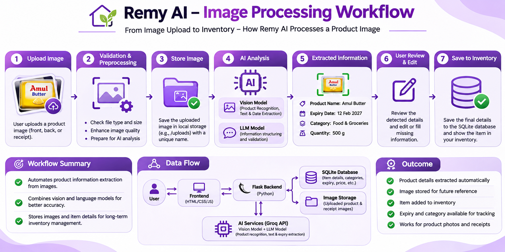

# Remy AI | Smart Household Inventory Management

<p align="center">
  <strong>An AI-powered inventory management system designed for modern Indian households.</strong>
</p>

<p align="center">
  
  
  
  
</p>

---

## 📸 Application Dashboard

<p align="center">
  
</p>

## 📌 About the Project

**Remy AI** is an intelligent household inventory management application that simplifies how users organize, track, and manage everyday household items.

It combines traditional inventory management with AI-powered product recognition, expiry tracking, and intelligent assistance to create a centralized household management experience.

Designed specifically for Indian households, Remy AI supports local measurement units, Indian currency, and practical household storage organization.

## ✨ Key Features

- **Smart Inventory Management:** Organize groceries, household supplies, and personal assets.
- **AI-Powered Product Scanning:** Extract product information from uploaded images.
- **Expiry & Warranty Tracking:** Monitor food expiry dates and household asset warranties.
- **Receipt Scanning:** Extract available information from purchase receipts.
- **Remy AI Assistant:** Get AI-powered assistance for household inventory and food-related queries.
- **Inventory Value Tracking:** Monitor the value of household inventory.
- **Indian Household Support:** ₹ INR, Indian measurement units, and household storage locations.

## 🏗️ Application Architecture

Remy AI follows a client-server architecture connecting the frontend, Flask backend, database, image storage, and AI services.

<p align="center">
  
</p>

### Technology Stack

| Technology | Purpose |
|---|---|
| Python | Backend development |
| Flask | Web application framework |
| HTML5, CSS3, JavaScript | Frontend development |
| SQLite | Database management |
| Groq API | AI model integration |
| AI Vision Models | Product image analysis |

## 🖼️ Image Processing Workflow

<p align="center">
  
</p>

The workflow illustrates how Remy AI processes uploaded images, validates files, extracts product information using AI, and integrates the results into the inventory.

## 🚀 Getting Started

### Prerequisites

- Python 3.10 or later
- Git
- pip

### Installation

**1. Clone the repository**

```bash
git clone https://github.com/YOUR_USERNAME/Remy-AI.git
cd Remy-AI
```

**2. Create and activate a virtual environment**

```bash
python -m venv venv
```

Windows:

```bash
venv\Scripts\activate
```

Linux / macOS:

```bash
source venv/bin/activate
```

**3. Install dependencies**

```bash
pip install -r requirements.txt
```

**4. Configure environment variables**

Create a `.env` file in the project root:

```env
GROQ_API_KEY=your_api_key_here
```

Use the API key required by your configured AI provider. Never commit API keys to GitHub.

**5. Run the application**

```bash
python app.py
```

Open the application in your browser:

```text
http://127.0.0.1:5000
```

## 🔮 Future Improvements

- Advanced barcode and QR code recognition
- Smart shopping list generation
- Low-stock notifications
- Inventory analytics and consumption insights

## 👨‍💻 Author

**Akash Singh**

[GitHub](https://github.com/YOUR_USERNAME) · [LinkedIn](YOUR_LINKEDIN_URL)

---

<p align="center">
  <strong>Remy AI — Smarter Inventory Management for Everyday Living.</strong>
</p>
